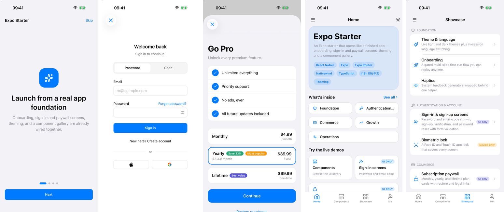

# Expo Starter

An open-source Expo + React Native app starter that opens like a finished app: onboarding, a
terms consent gate, sign-in and paywall screens, four tabs, a capability Showcase, a component
gallery, light and dark themes, and English and Chinese. Clone it, run it in Expo Go, and replace
the demo content with your product.

[](https://github.com/soarstarter/expo-starter/actions/workflows/ci.yml)
[](LICENSE)


<p align="center">
  
</p>

It runs fully locally: no account, no backend, no `.env` file, and the app itself sends no network
requests. The sign-in and paywall screens are real screens with working form validation; submitting
them shows a notice until you connect your own backend (see
[Connect your own backend](#connect-your-own-backend)).

Building for the desktop? [Electron Starter](https://github.com/soarstarter/electron-starter) and
[Tauri Starter](https://github.com/soarstarter/tauri-starter) are the desktop editions.

## Features

**App shell**

- Expo Router with four tabs (Home, Components, Showcase, Me), a drawer menu, modal and pushed
  screens, and a themed error boundary.
- An offline banner that is not mounted by default; its page in the component gallery shows how to
  turn it on. Once it is on, NetInfo checks reachability on iOS by requesting
  `https://clients3.google.com/generate_204`. Point `reachabilityUrl` in `NetInfo.configure` at
  your own endpoint if you prefer.
- First-run onboarding carousel and a terms consent gate that asks again when the terms version
  changes; Terms of Service, Privacy Policy, and EULA screens.
- Light, dark, and system themes, and English and Chinese switchable at runtime. The first launch
  follows the device language.
- A device settings section on the Me tab: appearance, language, app lock, permissions, and legal.

**Screens ready for your backend (UI only)**

- Sign-in with password or a one-time email code, sign-up with an email verification step, forgot
  and reset password, and Apple and Google buttons.
- A paywall with monthly, yearly, and lifetime plan cards, a feature list, restore purchases, and
  legal links. The plans are sample data.
- Forms use React Hook Form and Zod, with inline errors, loading states, and an auto-advancing
  code input.

**Device capabilities**

- App lock with Face ID, Touch ID, or fingerprint: locks on launch and after 30 seconds in the
  background, and covers every screen, including modals.
- `expo-starter://` deep links, validated against a fixed route list, plus optional Universal
  Links and App Links.
- Permission primers for the camera, photo library, and App Tracking Transparency.
- In-app rating prompt with frequency rules, haptics, and a share sheet for invite links.

**UI kit**

- [React Native Reusables](https://reactnativereusables.com) components styled with NativeWind,
  a bottom sheet, dialog, toast, skeleton, and keyboard-aware screens.
- A component gallery with a page for each component.

**Showcase**

- A catalog of the capabilities above with a live demo for each, labeled "UI only" where the screen
  has no backend behind it.

**Quality**

- Jest tests for the settings, consent, onboarding, rating rules, app lock, form schemas, deep
  links, catalogs, and locale files.
- TypeScript strict mode, ESLint, Prettier, and a CI workflow that also runs
  `expo install --check` and exports the iOS, Android, and web bundles.

## Quick start

1. Install Node.js 22.13 or later (24 LTS recommended) and pnpm 10.
2. Clone and run:

   ```bash
   git clone https://github.com/soarstarter/expo-starter.git
   cd expo-starter
   pnpm install && pnpm dev
   ```

3. Open the app:
   - **On a phone:** install [Expo Go](https://expo.dev/go) and scan the QR code in the terminal.
   - **iOS Simulator** (macOS with Xcode): press `i`. Expo Go is installed for you.
   - **Android emulator** (Android Studio): press `a`.
   - **Web:** press `w`.

No configuration is needed. [`.env.example`](.env.example) lists the optional settings: a domain
for Universal Links and App Links, store page URLs for the rating fallback, and hosted copies of
the legal documents.

In Expo Go, system prompts use Expo Go's name and text: the permission dialogs say "Expo Go", and
the rating prompt rates Expo Go itself. Face ID also needs a build of your own on a physical
iPhone. A local build (below) shows your app's own name and permission texts.

The Expo Go app in the App Store and Google Play only runs projects on the latest Expo SDK. If a
newer SDK is out and this repository has not been upgraded yet, scanning the QR code on a phone
will fail. Use a simulator, which lets Expo install a matching Expo Go, or a local build instead.

### Local build

To run the app as a native build with its own name, icon, and `expo-starter://` scheme:

```bash
pnpm exec expo run:ios       # needs Xcode
pnpm exec expo run:android   # needs Android Studio
```

## Lite and Pro

This repository is the free, MIT-licensed edition. Everything that needs a backend service or a
release pipeline lives in
[SoarStarter Pro](https://soarstarter.com/expo?utm_source=github&utm_campaign=expo-lite).

|                                                                                         | Expo Starter (this repo) | SoarStarter Pro |
| --------------------------------------------------------------------------------------- | :----------------------: | :-------------: |
| App shell: Expo Router, four tabs, drawer, error boundary, opt-in offline banner        |            ✅            |       ✅        |
| Onboarding, terms consent gate, and legal screens                                       |            ✅            |       ✅        |
| Sign-in, sign-up, email code, and password reset **screens**                            |            ✅            |       ✅        |
| Paywall **screens**                                                                     |            ✅            |       ✅        |
| Light and dark themes, English and Chinese                                              |            ✅            |       ✅        |
| Component gallery and Showcase                                                          |            ✅            |       ✅        |
| Deep links, permission primers, in-app rating, app lock                                 |            ✅            |       ✅        |
| Working email and code sign-in, profiles, and avatars (Supabase)                        |                          |       ✅        |
| Native Sign in with Apple and Google Sign-In                                            |                          |       ✅        |
| Account security: change email or password, sign out other sessions, delete account     |                          |       ✅        |
| In-app purchases, subscription management, entitlements, and feature gates (RevenueCat) |                          |       ✅        |
| Synced data example with offline caching, and file uploads                              |                          |       ✅        |
| Push notifications                                                                      |                          |       ✅        |
| Unified backend that shares accounts and data with the SoarStarter web app              |                          |       ✅        |
| EAS Build profiles, three environments, OTA updates, and a required-update gate         |                          |       ✅        |
| Error reporting (Sentry) and product analytics (PostHog)                                |                          |       ✅        |

The Showcase tab lists the Pro capabilities at the end; each row opens the Pro page.

## Scripts

| Command                             | What it does                                                                         |
| ----------------------------------- | ------------------------------------------------------------------------------------ |
| `pnpm dev`                          | Start Metro with a clean cache; press `i`, `a`, or `w` to open the app               |
| `pnpm ios` / `pnpm android`         | Start Metro and open the iOS Simulator or Android emulator                           |
| `pnpm web`                          | Start Metro and open the app in a browser                                            |
| `pnpm typecheck`                    | Type-check with `tsc`                                                                |
| `pnpm lint`                         | Lint with `expo lint`                                                                |
| `pnpm test`                         | Run the Jest tests                                                                   |
| `pnpm format:check` / `pnpm format` | Check or apply Prettier formatting                                                   |
| `pnpm exec expo install --check`    | Check that Expo packages match the SDK version                                       |
| `pnpm check:lite`                   | Check that no backend SDKs, network calls, or secrets got in (see `CONTRIBUTING.md`) |
| `pnpm generate:assets`              | Generate the icon, adaptive icon, splash, and favicon from one image                 |
| `pnpm clean`                        | Remove `.expo` and `node_modules`                                                    |

## Project structure

```text
app/                     Routes (Expo Router)
  (tabs)/                Home, Components, Showcase, and Me tabs
  (auth)/                Sign-in, sign-up, forgot and reset password (UI only)
  paywall.tsx            Paywall (UI only) with sample plans
  showcase/, component/  Showcase demos and component gallery pages
  legal/                 Terms, Privacy, and EULA
components/
  ui/                    React Native Reusables components
  auth/, paywall/        Sign-in, sign-up, and paywall views; they take callbacks and hold no logic
  settings/              Device settings section on the Me tab
lib/                     Providers and helpers: i18n, theme, consent, onboarding, app lock, deep links
  i18n/                  en.json and zh.json
  showcase/              Showcase capability catalog
__tests__/               Jest tests
```

Path alias: `@/` maps to the repository root, for example `@/components/ui/button`.

## Connect your own backend

The views in `components/auth/` and `components/paywall/` never call a service. They receive
callbacks from the route files, which is the only code you need to change:

| Screen                  | File                             | Callbacks to implement                                           |
| ----------------------- | -------------------------------- | ---------------------------------------------------------------- |
| Sign-in                 | `app/(auth)/login.tsx`           | `onSignIn`, `onSendLoginOtp`, `onVerifyLoginOtp`, social buttons |
| Sign-up                 | `app/(auth)/sign-up.tsx`         | `onSignUp`, `onVerifyEmailOtp`, `onResendEmailOtp`               |
| Forgot password         | `app/(auth)/forgot-password.tsx` | the form's `onSubmit`                                            |
| Reset password          | `app/(auth)/reset-password.tsx`  | the form's `onSubmit`                                            |
| Paywall (modal and tab) | `app/paywall.tsx`                | `plans`, `onPurchase`, `onRestore`                               |

The sign-in and sign-up callbacks return `{ ok: true }` or `{ ok: false, error }` (see
`components/auth/types.ts`), and the form shows the error or moves to the next step. Today they call
`useUiDemoNotice()` from `lib/ui-demo.ts`; once every screen is connected, delete that file and the
`uiDemo` locale keys.

## Deep links

The app registers the `expo-starter://` scheme in local builds (Expo Go uses its own `exp://` URLs):

```bash
xcrun simctl openurl booted 'expo-starter://showcase'                     # iOS Simulator
adb shell am start -a android.intent.action.VIEW -d 'expo-starter://showcase'  # Android
```

Only the routes listed in `lib/deep-links.ts` are opened; anything else goes to Home. Set
`EXPO_PUBLIC_LINKING_DOMAIN` to add Universal Links and App Links for your domain.

## Make it yours

- **Brand:** change the name, slug, scheme, and bundle identifier in `app.config.ts`, the
  metadata in `package.json`, and the display name in `lib/i18n/*.json`, then run
  `pnpm generate:assets path/to/icon.png`. The full list is in
  [docs/CUSTOMIZE.md](docs/CUSTOMIZE.md).
- **Showcase:** [docs/CUSTOMIZE.md](docs/CUSTOMIZE.md) lists the demo-only files and the few
  places that link to them, so you can remove the Showcase and the component gallery.
- **Going further:** the
  [SoarStarter Pro documentation](https://soarstarter.com/docs/expo?utm_source=github&utm_campaign=expo-lite)
  covers the full template. Its installation and configuration pages are a useful reference
  here too; the pages on authentication, backends, subscriptions, EAS builds, and store release
  describe Pro modules.

## Contributing and security

Bug fixes and small improvements are welcome; see [CONTRIBUTING.md](CONTRIBUTING.md). To report a
vulnerability, follow [SECURITY.md](SECURITY.md) instead of opening a public issue.

## License

Expo Starter is released under the [MIT License](LICENSE). You can use, modify, and distribute it,
including in commercial and closed-source apps, as long as the copyright and license notice in
[LICENSE](LICENSE) is included in all copies or substantial portions of it.

Third-party libraries keep their own licenses; the main ones are listed in
[CREDITS.md](CREDITS.md).
